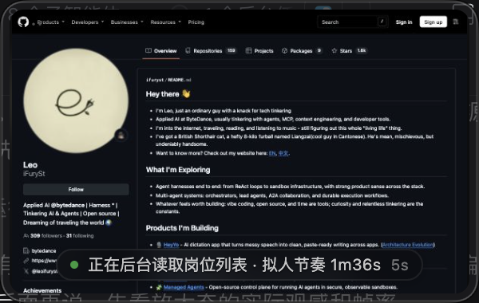
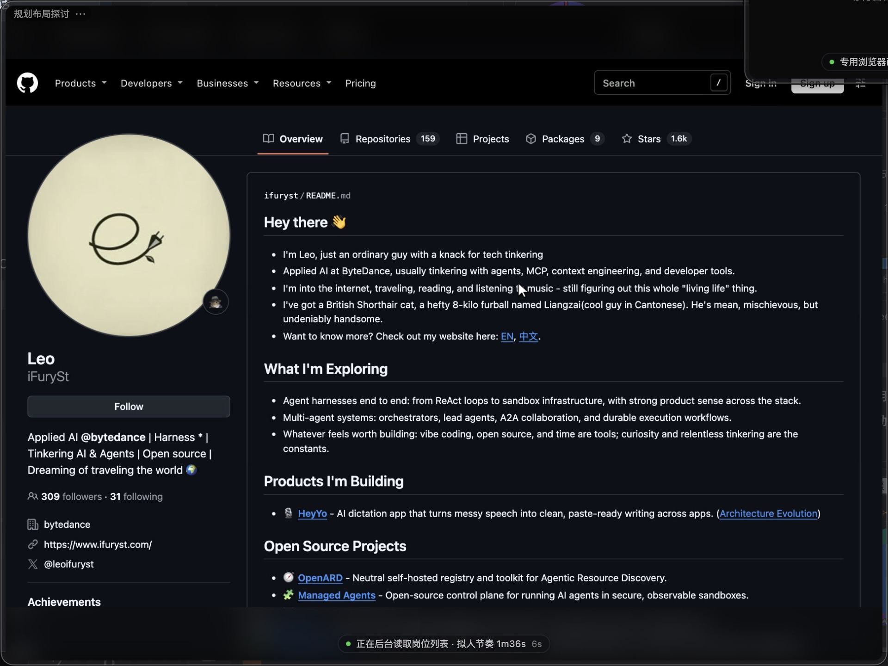

# Desktop Agent

[](https://github.com/USER/desktop-agent/actions/workflows/ci.yml)

> 后台电脑控制 + 小窗回显。所有操作在你的真实应用里完成，但全程不抢焦点、不动你的鼠标、不切你的窗口。

一个自用的 macOS 桌面自动化框架：**控制层**用 Accessibility 语义树驱动真实应用，**展示层**用一个贴在 DSH 窗口里的小窗实时回显它在干什么，**调度层**是常驻后台的 daemon 加任务运行器。

## 它解决什么问题

浏览器自动化脚本会弹窗、抢焦点、切标签页，人在电脑前就没法干活。这个项目的前提是：**自动化必须在后台跑，人能同时正常用电脑**。

所以它做了三件事：

1. **不打扰**：用 Accessibility 语义动作点击，不移动系统指针；窗口用 `showInactive` 显示，不激活应用。
2. **看得见**：需要时浮现一个小窗，实时显示被控窗口画面和当前动作；空闲 5 秒自动消失。
3. **可验证**：每个任务都有明确的成功判据，不是「跑完了」就算成功。

## 架构

```
┌─────────────────────────────────────────────┐
│ daemon (127.0.0.1:7789)                     │
│  · 串行任务队列  · 重试  · JSONL 日志        │
└───────────────┬─────────────────────────────┘
                │ 调度
┌───────────────▼─────────────────────────────┐
│ 任务层 core/tasks/                          │
│  · AX 控制真实应用  · 离屏浏览器  · CDP      │
└───────────────┬─────────────────────────────┘
                │ 状态 / 帧
┌───────────────▼─────────────────────────────┐
│ overlay (127.0.0.1:7788)                    │
│  · 多会话小窗  · 实时缩略图  · 点击穿透      │
└─────────────────────────────────────────────┘
```

## 快速开始

> 日常使用、排查、命令速查见 [docs/USAGE.md](docs/USAGE.md)。


环境要求：macOS 14+、Node.js 20+、[open-computer-use](https://github.com/iFurySt/open-computer-use)（`ocu`）。

```bash
# 0. 环境自检（换机器先跑这个）
npm run doctor

# 1. 装依赖（根目录与 overlay 一起）
npm run setup

# 2. 装成开机自启（macOS launchd / Windows 计划任务）
npm run service:install

# 或者只临时启一下
npm run daemon

# 3. 看状态
npm run status

# 4. 跑任务
npm run run browser-demo
```

## 三种运行方式（都不同屏）

| 方式 | 屏幕上有没有窗口 | 用什么控制 | 适合 |
| --- | --- | --- | --- |
| **headless 浏览器** | 完全没有 | CDP（页面内鼠标键盘） | 网页自动化，最干净 |
| **你自己的 Chrome** | 有，但不抬、不切、不抢焦点 | AX 元素点击 + `sky_key` | 需要你看着/已登录的页面 |
| **离屏实例** | 无（窗口在屏幕外） | CDP | 需要独立登录态 |

headless 模式下小窗通过 CDP 截图推帧显示画面（约 10fps），带虚拟光标与点击波纹——**你的屏幕上不存在那个浏览器窗口**。

```bash
node core/runner.mjs run headless-demo    # 启动、导航、拟人点击、推帧、验证零窗口
```

## 拟人操作

- 点击：三次贝塞尔弧线 + 缓入缓出变速 + 每步抖动，末点精确落点（`core/humanize.mjs`）
- 输入：按码点分段、随机节奏、偶发打错并退格纠正
- 护栏：对用户应用默认禁止截图式坐标点击（会把窗口抬到前台），改走 element_index 语义点击

真机验证（往 TextEdit 后台打字，不切前台，结束自动还原原文）：

```bash
npm run humanize:live     # 约 11 秒，证据写到 reports/humanize-live-*.md
```

最近一次实测：23 个字分 11 段输入、中途打错 6 次并退格纠正、平均 297ms/字；
鼠标轨迹 31 步 / 426px / 440ms；**前台全程是 DSH 没变**，TextEdit 原文已还原。

## 和 ocu 的集成方式

不走「每次 spawn 一个 CLI」的老路，而是用 **MCP 长连接**：一次握手后连续调用，复用同一个原生会话。

| 方式 | 每次动作开销 | 元素索引 |
| --- | --- | --- |
| `spawn ocu js`（旧） | 200–400ms 起进程 | 每次重置 |
| **MCP 常驻（现在）** | 40–140ms | 120 秒内可复用 |

实测：握手 41ms，`get_app_state` 43ms，连续两次 `list_apps` 从 139ms 降到 107ms。

```js
import { getOcuMcp } from './core/ocu-mcp.mjs';
const mcp = await getOcuMcp();      // 进程内共享一个连接
await mcp.callTool('get_app_state', { app: 'Google Chrome' });
```

## 作者做了什么

这个项目不是「包一层别人的工具」，它有 ~11000 行自己写的代码和 4000 行文档：

| 模块 | 行数 | 内容 |
| --- | --- | --- |
| `core/` | 6000+ | daemon、任务队列、平台抽象、MCP 客户端、CDP 客户端、拟人输入、验收框架、17 个任务 |
| `overlay/` | 2788 | Electron 多会话小窗主进程、HTTP 服务、渲染层、会话门控、点击穿透 |
| `scripts/` | 381 | 仓库体检、重启自检、版本同步、效率基准、打包 |
| `test/` + `tools/` | 286 | 单元测试、Windows UIA 桥 |

其中**完全自主设计的部分**：

1. **可验证执行**：任务的成功判据不靠脚本自证，而是读外部事实（消息列表差集）。这条抓出过一次 8 连假报。
2. **多会话小窗**：会话标题门控、点击穿透、按画面比例放大、空闲自愈隐藏规则。
3. **平台抽象**：同一套代码在 macOS（ocu/Accessibility）和 Windows（UIA 兜底）间切换，随包运行时与全局安装自动适配。
4. **调度与护栏**：应用级文件锁、前台守卫、连续失败自动停。

底层「能操作应用」的能力来自 open-computer-use（MIT），**没有被修改，通过 MCP 协议调用**。详见 [THIRD-PARTY.md](THIRD-PARTY.md) 与 [flow/OCU-INTEGRATION.md](flow/OCU-INTEGRATION.md)。

## 这个项目的特点在哪

底层「能操作 macOS 应用」的能力来自开源项目 ocu，不是本项目自研。**本项目真正的价值在三件事上**：

1. **小窗回显**：后台在操作什么，屏幕角落有一块实时画面能看见——有活动才浮现、空闲自动消失、点中间会穿透到下面的界面，不挡你干活；多会话时每个会话只看自己的窗口。
2. **后台调度**：daemon + 任务队列 + 应用锁 + 前台守卫。自动化在后台跑，你同时正常用电脑；目标应用一跑到前台就自动中止。
3. **可验证**：每个任务都有独立于「脚本自己说成功」的判据。BOSS 投递那条正是靠这个抓出 8 条误报——弹窗说已发送，消息列表里根本没有。

换句话说：ocu 提供「手」，本项目提供「眼睛、调度和验收」。

**分层定位**：

```
系统层能力   Accessibility / UIA / CGEvent / SkyLight   ← 由 ocu 的原生运行时 + 操作系统提供
接口层       ocu 的 CLI 与 JS API                        ← 我们调用
软件本体     daemon / 任务 / 小窗 / 验证                   ← 本项目，应用层软件
```

和 Codex 的 computer use 是同一种形态：**对外是一个软件，内部依赖系统层能力**。区别是它自研了那层原生运行时，我们直接复用了开源实现。

## 依赖与归属

**底层控制能力来自开源项目 [open-computer-use](https://github.com/iFurySt/open-computer-use)（`ocu`，MIT）**：读 Accessibility 树、语义点击、后台键入都是它提供的。
本项目写的是调度、小窗、任务与验证这一层，没有 vendor 任何第三方源码。

| 依赖 | 作用 | 许可 |
| --- | --- | --- |
| open-computer-use（ocu） | 控制层核心，通过 **MCP 常驻连接**调用 | MIT |
| Electron | 小窗界面 | MIT |
| Google Chrome | 被驱动的浏览器 | 专有，用户自有 |

完整说明见 [THIRD-PARTY.md](THIRD-PARTY.md)。

## 跨平台

目标是一套代码同时支持 macOS 和 Windows。当前进度：

| 层 | macOS | Windows |
| --- | --- | --- |
| 小窗展示 | ✅ screencapture | ✅ PrintWindow（未实机验证） |
| 前台/窗口信息 | ✅ osascript | ✅ PowerShell + User32（未实机验证） |
| 控制（点击/读界面） | ✅ ocu | ✅ ocu（官方支持 Windows） |
| 后台输入 | ✅ sky_key（私有 SkyLight） | ✅ ocu 窗口消息投递 |
| 浏览器 | ✅ 离屏 Chrome + CDP | ✅ 逻辑通用 |

平台差异都收在 `overlay/platform.js`（渲染侧）和 `core/platform.mjs`（逻辑侧），业务代码不再直接调 osascript。
详细缺口和移植路线见 [flow/CROSS-PLATFORM.md](flow/CROSS-PLATFORM.md)。

**诚实说明**：Windows 分支是照 Win32 API 写的，没在真实 Windows 上跑过——当前开发机是 macOS。

## 目录

```
core/
  agentd.mjs        # ocu 封装 + overlay 客户端 + 互斥锁 + 前台守卫
  runner.mjs        # 任务注册、重试、日志
  daemon.mjs        # 常驻 HTTP 服务，串行队列
  acceptance.mjs    # 端到端验收
  browser.mjs       # 离屏 Chrome 管理（后台启动、恢复前台）
  cdp.mjs           # 零依赖 CDP 客户端
  human.mjs         # 拟人鼠标轨迹与输入
  tasks/            # 具体任务
overlay/            # Electron 小窗（多会话、缩略图、穿透）
flow/               # 每个流程的方法论与踩坑记录
```

## 小窗

- 贴在 DSH 窗口右上角，跟随 DSH；DSH 失焦自动隐藏
- 空闲 5 秒淡出，鼠标悬停时暂停隐藏
- 默认点击穿透：只有右上角 `⤢` / `✕` 和顶部 8px 拖拽条接管鼠标
- `⤢` 按画面比例放大到屏幕中央，再点还原
- 支持多会话：每个会话一个独立窗口，按 DSH 当前对话标题门控
- 任务运行中右上角出现红色 `■` 停止按钮：点一下即停（走 `POST /stop-task`，主动停止不会被当成失败去重试）

小窗收起时（300×190，后台正在读岗位列表，右下角是状态胶囊与虚拟光标）：



点 `⤢` 放大看细节（960×600，画面按 2× 出图，1920×1200 像素）：



多会话并存时，每个会话一个窗口：


## 控制层

我不用截图猜坐标，走 Accessibility 语义树：

| 动作 | 实现 |
| --- | --- |
| 读界面 | `ocu` 拉 AX 树，按角色/文本定位元素 |
| 点击 | `accessibility` 语义动作，不移动系统指针 |
| 输入 | `sky_key` 后台键入，不激活窗口 |
| 截图 | `screencapture -l <windowId>` 按窗口抓，不受遮挡影响 |

离屏场景（浏览器、Electron）另走 CDP，用独立 profile 起一个后台实例，抓完再恢复原前台。

## 从底层支持：按运行时归类，不逐个应用适配

支持能力按**运行时族 + 控制通道**设计，而不是给每个应用写一套：

- 识别层不启动应用，只看包结构（Electron 框架、`app.asar`、mojo/Renderer Helper、Qt、JVM、`.sdef` 字典），
  判断它属于哪一族；本机 27 个应用归出来是 electron 5、chromium 2、qt 1、native 19
- 通道层按前提协商：AX 语义 → CDP 调试端口 → AppleScript 字典 → 画面坐标，逐条验前提、失败降级
- 驱动层是同一套 `core/background.mjs` 函数，同类应用共用一条链

所以给 Electron 族做的驱动，ChatGPT、OpenCode、抖音、宿主自己一起受益；QQ 和微信同属 Chromium 自研壳，修一条链两个都好。

```bash
npm run app:runtime -- Steam          # 看单个应用归到哪族、该走什么通道
npm run app:runtime -- --all --user   # 把 /Applications 里自己装的应用归类一遍
npm run cdp:channel                   # CDP 通道端到端自检（自建 Chromium 实例，4 项）
npm run cdp:apps                      # 看本机 Electron 应用愿不愿意开调试端口
npm run as:channel                    # AppleScript 通道自检（先静默查授权，不弹授权框）
```

细节和依据见 [docs/APP-SUPPORT-ARCHITECTURE.md](docs/APP-SUPPORT-ARCHITECTURE.md)。

## 后台能控制哪些软件（实测）

```bash
npm run bg:verify            # 一条命令跑完全部验收，输出 reports/bg-verify-*.md
MATRIX_PRESET=im npm run matrix   # 按门类批量探测：office / im / dev / system / media / tools
```

按门类实测过的应用（读界面 / 操作 / 画面回显 / 前台是否被抢）：

| 门类 | 应用 | 读界面 | 操作 | 画面 | 前台未变 |
| --- | --- | --- | --- | --- | --- |
| 笔记 | 备忘录 | 是 | 新建、写正文 | 视窗口所在桌面 | 是 |
| 文档 | 文本编辑 | 是 | AX 设值 | 是 | 是 |
| 计算器 | 计算器 | 是 | 点按钮 | 是 | 是 |
| 文件管理 | 访达 | 是 | 点按钮、输入框 | 是 | 是 |
| 系统设置 | 系统设置 | 是 | 点按钮 | 是 | 是 |
| 代理工具 | Clash Verge | 是 | 读状态 | offscreen | 是 |
| 聊天 | Telegram | 是 | 只露壳（自绘窗口） | 是 | 是 |
| 终端 | Ghostty | 是 | 键入命令 + 回车 | offscreen | 是 |
| Electron 聊天 | ChatGPT | 是 | 点按钮 | 是 | 是 |
| Chromium 应用 | Steam | 是 | 读界面（0 个 AX 按钮） | 是 | 是 |
| 视频剪辑 | iMovie | 是 | 点按钮 | 是 | 是（读取瞬间会抢，自动还原） |
| 第三方办公 | Pages Creator Studio | 是 | 点按钮 | 是 | 是（首启弹窗会卡 Apple 事件，脚本自动点掉） |
| 限制项 | 抖音 / Antigravity | 否 | 否 | 否 | 应用自身启动即退出，不是控制层问题 |

完整的分门类策略、每个坑的成因与对策、21 个应用的实测记录见 [docs/MAC-APPS.md](docs/MAC-APPS.md)。

除上表列的操作外，还支持：元素自带次要动作（如笔记行的删除/置顶）、滚动列表、选中文本；
> 每个应用吃哪种输入方式会被记在 `~/.desktop-agent/capabilities.json`，第二次直接走对的路。

已知边界（文档里都写了原因）：

- **菜单栏命令不可用**：菜单不展开时系统不暴露菜单项，AXMenuItem 查询恒为 0
- **浏览器要用独立实例**：Chrome 直接启动或 open -g 启动都会自己抢前台
- **别的桌面的窗口**：能后台操作，但画面抓到的是纯色帧（标 offscreen）；判定会先解码抽样确认真是整块纯色，不会把纯黑/纯白的正常窗口误标
- **快捷键会激活应用**：带修饰键的快捷键（如 ⌘N）不适用于后台
- **AppleScript 自动化会弹权限框**：后台流程禁用，只走 System Events 的 AX 通路
## 安全边界

这是给「操作自己的账号」设计的工具，不是爬虫框架。约定写死在代码里：

- 目标应用变成前台就中止任务（`guard()`）
- 同一应用加文件锁，禁止并发操作（`withAppLock()`）
- 不自动过验证码：命中验证页立即中止并报告
- 高频操作要限速，风控权重是累积的
- daemon 的任务名按「任务目录里真实存在的文件」白名单校验，`../` 这类名字直接 400，不会被拿来越界执行脚本
- 小窗 HTTP 只监听 127.0.0.1，session 字段做白名单校验；Windows 侧反查窗口时，
  外部传入的窗口标题一律按 PowerShell 单引号字符串转义（`overlay/ps-quote.js`，带 7 项单测），
  防止标题里藏 `$(...)` 造成命令注入

## 案例：BOSS 直聘投递

`flow/BOSS-GREET.md` 记录了完整方法论，其中一条最有价值：

> **平台弹窗「已发送」不代表真的送达。** 唯一可信的判据是消息列表前后差集。

这个项目早期正是因为拿弹窗当成功信号，连续 8 次误报。修好后的判定链是：详情 id 精确比对 → 按钮文案判断是否已联系 → 消息列表差集验收。

## 打包成单机 App

```bash
node scripts/bundle-ocu.mjs --with-binary    # 把 ocu 运行时放进 third_party
cd overlay && npx electron-builder --mac dir --config electron-builder.yml
```

产出 `Desktop Agent.app`（约 300MB，含 Electron + ocu），**装完即可用，不需要另外装 Node 或 ocu**——已验证把全局 ocu 删掉后 App 仍完整可用。
细节见 [flow/PACKAGING.md](flow/PACKAGING.md)。

## 打包上传

```bash
bash scripts/export.sh    # 生成 dist/desktop-agent-<version>.tar.gz，排除依赖与运行时产物
```

首次在 Windows 上运行，请按 [flow/WINDOWS-TESTING.md](flow/WINDOWS-TESTING.md) 的清单逐项确认。

## 测试与验收

```bash
npm run monitor   # 一键巡检：健康 + 小窗回归 + 会话隔离 + 帧率，结果写 reports/monitor-*.md
npm run health    # 一条命令看全局（服务/身份权限/小窗/队列/失败）
npm run health -- --deep   # 再加上 14 项小窗效果回归
npm run scope:check        # 小窗只在该会话出现？切走/切回各要多久？（逐项给出毫秒）
npm run fps:check          # 帧率压测：实际帧率、单帧体积、推帧耗时（FPS_CHECK_EXPANDED=1 测放大态）
npm run soak               # 稳定性巡检：连跑 6 轮任务，看耗时、内存增长、有没有有效帧
npm run accept    # 端到端验收（需要本机服务在跑）
npm run verify    # 提交前一条龙：语法检查 + 单元测试 + 仓库体检
npm run repo:check # 仓库体检：版本一致、无依赖产物、无大文件、无隐私泄漏、文档命令/图片不漂移
npm test          # 单元测试（打分、薪资解析、平台探测、标题门控、失败归类）
npm run check     # 语法检查
npm run restart:check  # 重启两个服务再验证健康（抓「跑的是旧代码」这类问题）
```

CI 在 Ubuntu / macOS / Windows 三平台跑 `npm test` 与 `npm run check`。

监控口径、各项指标怎么看、锁屏时哪些数据不可信，见 [flow/MONITORING.md](flow/MONITORING.md)。

端到端验收会跑一遍服务在线、小窗显隐、各任务，输出 Markdown 报告到 `reports/`。
「环境不具备」（用户正在用目标应用、没开指定页面、锁屏、缺辅助功能权限）会记为
环境跳过并在报告里注明原因，不算失败；归类规则只有一份，见 `core/run-classify.mjs`。

已知问题：`form-fill` 在 overlay 同时运行时可能失败——本机 Electron 宿主抢不到窗口句柄（`cgWindowNotFound`），属于环境冲突，不是逻辑错误。

## Roadmap

- [ ] Windows 控制后端（UI Automation），补齐 click/typeText/pressKey
- [ ] Windows 服务自启（schtasks 安装脚本）
- [ ] 任务参数化（筛选标准可配置，先出清单再执行）
- [x] 小窗只出现在召唤它的会话；切走 ~0.5s 收起、切回 ~0.7s 重新出现
- [x] 帧率/清晰度按窗口尺寸自适应（收起 600px、放大 1920px）
- [ ] 小窗支持更多会话元信息（任务进度、耗时）
- [ ] 更完整的失败重试策略

## 变更记录

见 [CHANGELOG.md](CHANGELOG.md)。

## License

MIT