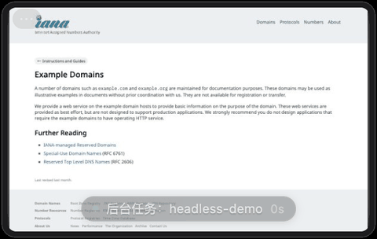
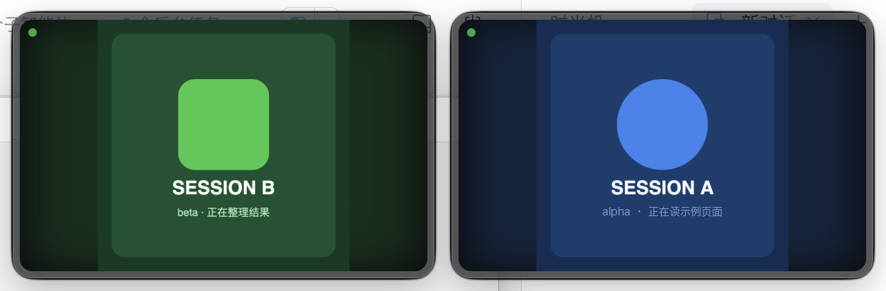

[English](README.md) · [简体中文](README.zh-CN.md)

# DSH Rig

**Control real macOS apps in the background — without stealing your focus.**

[](https://github.com/goodlifedog/dsh-rig/actions/workflows/ci.yml)
[](https://www.npmjs.com/package/dsh-rig)
[](LICENSE)
[](package.json)



*A headless Chrome session opens a demo page in the background while the overlay mirrors what the agent sees. The foreground stayed on DSH the whole time — no window switching, no focus stealing.*

**Keywords**: macos · accessibility · computer-use · background-automation · no-focus-steal · overlay · electron · screenshot · cdp · devtools-protocol · ai-agent · cli · nodejs · task-runner · verification

**Install in one line**: `npm i -g dsh-rig`, then `dsh-rig start`.

**What it is**: a **visible, verifiable** background-control layer. The **control layer** drives real apps through the Accessibility tree; the **display layer** is a small overlay pinned to your window (showing what the agent is doing); the **scheduling layer** is a resident daemon plus a task runner. Multiple channels (AX / CDP / AppleScript / screen) and runtime-family classification are just **implementation details**; the point is **overlay feedback, background scheduling, and verifiable results** — not yet another automation framework.

**Clone and run**:

```bash
git clone https://github.com/goodlifedog/dsh-rig.git && cd dsh-rig
npm run setup      # install dependencies (root + overlay)
npm run doctor     # environment check: ocu / permissions / overlay / daemon
npm run daemon     # start the background service
```

> Measured limits: while you are actively using the machine, a concurrent verification run (hidden apps + headless browsers working at the same time) gave **273/273 foreground samples on your own app, 0 steals, no new windows on screen**.
> This is not literally "zero flicker in all cases" — apps known to grab the foreground themselves (Telegram/ChatGPT/QQ/Gemini/Ghostty/WPS, etc.) are skipped by default through a risk list;
> if an app not on the list flickers when first read, it is restored immediately and added to the list. Full acceptance runs that touch the screen only run after a long idle period, and stop within 1–2 seconds of any keyboard/mouse input.

> Project rules for agents and contributors live in [AGENTS.md](AGENTS.md); day-to-day usage, troubleshooting, and the command cheat sheet live in [docs/USAGE.md](docs/USAGE.md).

## What problem it solves

Browser-automation scripts open windows, steal focus, and switch tabs, so you cannot keep working while they run. The premise of this project is: **automation must run in the background while you keep using the computer.**

So it does three things:

1. **Stay out of your way**: clicks use Accessibility semantic actions instead of moving the system pointer; windows appear with `showInactive` and never activate the target app;
   apps that grab the foreground by themselves are skipped by default (`npm run front:risk` lists and clears them); if one is stolen anyway, it is restored immediately and recorded;
   tasks that write into your content (notes, forms) yield as soon as you touch the keyboard.
2. **Stay visible**: when needed, a small overlay appears showing the controlled window and the current action; it fades out after 5 idle seconds.
3. **Stay verifiable**: every task has an explicit success criterion — "the script finished" is not success.

## Architecture

```text
┌─────────────────────────────────────────────┐
│ daemon (127.0.0.1:7789)                     │
│  · serial task queue · retries · JSONL logs │
└───────────────┬─────────────────────────────┘
                │ scheduling
┌───────────────▼─────────────────────────────┐
│ task layer core/tasks/                      │
│  · AX control of real apps · offscreen browser · CDP │
└───────────────┬─────────────────────────────┘
                │ state / frames
┌───────────────▼─────────────────────────────┐
│ overlay (127.0.0.1:7788)                    │
│  · multi-session HUD · live thumbnail · click-through │
└─────────────────────────────────────────────┘
```

## Quick start

> Day-to-day usage and troubleshooting: [docs/USAGE.md](docs/USAGE.md).

Requirements: macOS 14+, Node.js 20+. **Dependencies come with the install**: `npm i -g dsh-rig` also installs the underlying control library [open-computer-use](https://github.com/iFurySt/open-computer-use) (`ocu`) and the Electron runtime used by the overlay — nothing else to install.

First run the permission guide once: `npm run permissions:open` (opens the Accessibility / Screen Recording / Automation panes; tick the boxes, then re-run `npm run doctor`).

```bash
# 0. environment check (run this first on a new machine)
npm run doctor

# 1. (clone/repo development only) install dev dependencies; when installed globally, Electron and ocu are already bundled, so you can skip this
npm run setup

# 2. install as a login service (macOS launchd; Windows scheduled task is not verified on real hardware)
npm run service:install

# or start it just for now
npm run daemon

# 3. status
npm run status

# 4. run a task
npm run run browser-demo

# 5. verification (this group never touches the screen, so you can run it while using the computer)
npm run verify:safe            # 9 checks: syntax / safety / health / CDP / AppleScript / stability / concurrency…
npm run demo:concurrent        # concurrency proof: work in the background while you switch windows and type
```

## Three ways to run (all without sharing your screen)

| Mode | Window on screen | Control channel | Best for |
| --- | --- | --- | --- |
| **headless browser** | none at all | CDP (mouse/keyboard inside the page) | web automation, cleanest |
| **your own Chrome** | exists, not raised; some actions briefly activate it, then restore | AX element clicks + `sky_key` | pages you need to watch / are already logged in |
| **offscreen instance** | none (window off screen) | CDP | separate login state |

In headless mode the overlay receives CDP screenshots as frames (~10 fps) with a virtual cursor and click ripple — **that browser window does not exist on your screen**.

```bash
node core/runner.mjs run headless-demo    # launch, navigate, human-like click, push frames, verify zero windows
```

## Human-like input

- Clicks: cubic Bézier arc + ease-in/out speed + per-step jitter, exact landing point (`core/humanize.mjs`)
- Typing: split by code point, random rhythm, occasional typo with backspace correction
- Guardrail: screenshot-based coordinate clicking is disabled for user apps by default (it raises the window); element_index semantic clicks are used instead

Live verification (type into TextEdit in the background, keep the foreground unchanged, restore the original text afterwards):

```bash
npm run humanize:live     # about 11 seconds; evidence written to reports/humanize-live-*.md
```

Latest run: 23 characters typed in 11 segments, 6 typos corrected along the way, 297ms per character on average;
mouse path 31 steps / 426px / 440ms; **the foreground stayed on DSH the whole time**, and TextEdit's original text was restored.

## How it integrates with ocu

It does not spawn a CLI per action; it uses an **MCP long-lived connection**: one handshake, then repeated calls on the same native session.

| Approach | Cost per action | Element index |
| --- | --- | --- |
| `spawn ocu js` (old) | 200–400ms to start a process | reset every time |
| **MCP resident (current)** | 40–140ms | reusable for 120 seconds |

Measured: handshake 41ms, `get_app_state` 43ms, two consecutive `list_apps` dropped from 139ms to 107ms.

```js
import { getOcuMcp } from './core/ocu-mcp.mjs';
const mcp = await getOcuMcp();      // one connection shared inside the process
await mcp.callTool('get_app_state', { app: 'Google Chrome' });
```

## What the author built

This is not "a thin wrapper around someone else's tool": it has roughly 19,000 lines of original code and about 10,000 lines of documentation (numbers change as development continues; `wc -l` is the source of truth):

| Module | Lines | Contents |
| --- | --- | --- |
| `core/` | 12,500+ | daemon, task queue, platform abstraction, MCP client, CDP client, human-like input, acceptance framework, 26 tasks |
| `overlay/` | 4,000+ | Electron multi-session overlay main process, HTTP service, renderer, session gating, click-through |
| `scripts/` | 2,300+ | repo checks, restart self-check, version sync, benchmarks, packaging, cleanup, inspection |
| `test/` + `tools/` | 4,000+ | 500+ unit/integration tests, Windows UIA bridge |

The **fully original parts**:

1. **Verifiable execution**: success criteria come from external facts (read the value back / diff before and after), not from the script's own claims. This once caught 8 consecutive false reports.
2. **Multi-session overlay**: session-title gating, click-through, aspect-ratio expansion, idle self-healing visibility rules.
3. **Platform abstraction**: one codebase switching by platform (macOS verified on real hardware; the Windows branch follows Win32 APIs but is not verified on real hardware), with bundled runtimes and global installs adapting automatically.
4. **Scheduling and guardrails**: per-app file locks, foreground guards, automatic stop after repeated failures.

The underlying "can operate apps" capability comes from open-computer-use (MIT), **unmodified, called over the MCP protocol**. See [THIRD-PARTY.md](THIRD-PARTY.md) and [flow/OCU-INTEGRATION.md](flow/OCU-INTEGRATION.md).

## What makes this project different

The underlying "can operate macOS apps" capability comes from the open-source project ocu; it is not built here. **The real value of this project is three things**:

1. **Overlay feedback**: you can see what the background is doing in a live thumbnail in the corner of the screen — it appears only on activity, disappears when idle, passes clicks through in the middle so it never blocks your work; with multiple sessions, each session only sees its own window.
2. **Background scheduling**: daemon + task queue + per-app lock + foreground guard. Automation runs in the background while you keep using the computer; the moment the target app reaches the foreground, the task aborts.
3. **Verifiability**: every task has a criterion independent of "the script says it succeeded". The form-filling task is exactly how a false positive was caught: the page looked changed, but the value read back had not changed at all.

In other words: ocu provides the **hands**; this project provides the **eyes, the scheduling, and the acceptance checks**.

**Layering**:

```text
System layer   Accessibility / UIA / CGEvent / SkyLight   ← provided by ocu's native runtime + the OS
Interface      ocu CLI and JS API                         ← called by this project
Application    daemon / tasks / overlay / verification    ← this project, application-layer software
```

It has the same shape as Codex's computer use: **a single piece of software on the outside, system capabilities underneath**. The difference is that they built their own native runtime, while this project reuses an open-source implementation.

## Dependencies and attribution

**The underlying control capability comes from the open-source project [open-computer-use](https://github.com/iFurySt/open-computer-use) (`ocu`, MIT)**: Accessibility-tree reading, semantic clicks, and background typing all come from it.
This project writes the scheduling, overlay, task, and verification layers; no third-party source code is vendored.

| Dependency | Purpose | License |
| --- | --- | --- |
| open-computer-use (ocu) | core of the control layer, called over a **resident MCP connection** | MIT |
| Electron | overlay UI | MIT |
| Google Chrome | the browser being driven | proprietary, user-supplied |

Full details: [THIRD-PARTY.md](THIRD-PARTY.md).

## Cross-platform

The goal is one codebase supporting both macOS and Windows. Current status:

| Layer | macOS (verified on real hardware) | Windows (**not verified on real hardware**, written against Win32 APIs) |
| --- | --- | --- |
| Overlay display | ✅ screencapture | ⚠️ PrintWindow |
| Foreground/window info | ✅ osascript | ⚠️ PowerShell + User32 |
| Control (click/read UI) | ✅ ocu | ⚠️ ocu (upstream claims support) |
| Background input | ✅ sky_key (private SkyLight) | ⚠️ ocu window-message posting |
| Browser | ✅ offscreen Chrome + CDP | ⚠️ logic is portable |

Platform differences are isolated in `overlay/platform.js` (renderer side) and `core/platform.mjs` (logic side); business code no longer calls osascript directly.
Gaps and the porting plan: [flow/CROSS-PLATFORM.md](flow/CROSS-PLATFORM.md).

**Honest note**: the Windows branch is written against Win32 APIs and has never run on a real Windows machine — the current development machine is macOS.

## Repository layout

```text
AGENTS.md           # project rules for agents/contributors (safety boundaries, test gates, commit flow)
core/
  agentd.mjs        # ocu wrapper + overlay client + mutex + foreground guard
  runner.mjs        # task registration, retries, logs
  daemon.mjs        # resident HTTP service, serial queue
  acceptance.mjs    # end-to-end acceptance
  browser.mjs       # offscreen Chrome management (background launch, foreground restore)
  cdp.mjs           # zero-dependency CDP client
  human.mjs         # human-like mouse path and input
  tasks/            # concrete tasks
overlay/            # Electron overlay (multi-session, thumbnail, click-through)
flow/               # methodology and pitfalls for each workflow
_archive/           # one-off process records (gitignored, not in the repo/package)
```

## Overlay

- Pinned to the top-right of the DSH window and follows it; hides when DSH loses focus
- Fades out after 5 idle seconds; hovering pauses the hide timer
- Click-through by default: only the central `⤢`, the top-right `✕`, and the 8px drag strip around the edges capture the mouse
- `⤢` expands to screen center at the frame's aspect ratio, click again to restore (browser fullscreen-button style, appears on hover only)
- Multi-session: one window per session, gated by the current DSH conversation title
- Stopping a background task goes through `POST /stop-task` (no red stop button on the overlay, to avoid misclicks and visual noise)

Collapsed state (300×190; the background is reading a demo page; status pill and virtual cursor at the bottom-right):


Click `⤢` to expand and see details (960×600, captured at 2× = 1920×1200 px):


With multiple sessions, each session gets its own window:



## Control layer

No guessing coordinates from screenshots — it walks the Accessibility tree:

| Action | Implementation |
| --- | --- |
| Read UI | `ocu` pulls the AX tree; locate elements by role/text |
| Click | Accessibility semantic action; the system pointer does not move |
| Type | `sky_key` background typing; the window is not activated |
| Screenshot | `screencapture -l <windowId>` per window, unaffected by occlusion |

Offscreen scenarios (browsers, Electron) use CDP instead: a background instance with a dedicated profile, then the original foreground is restored.

## Runtime-family support: classify, don't adapt every app

Support is designed around **runtime families + control channels**, not per-app glue:

- The identification layer starts nothing; it only inspects bundle structure (Electron framework, `app.asar`, mojo/Renderer Helper, Qt, JVM, `.sdef` dictionary) to decide the family; on this machine, 32 apps classify as electron 5, chromium 3, qt 1, native 23
  (numbers change with installed apps; run `npm run apps:inventory` for current values)
- The channel layer negotiates by prerequisite: AX semantics → CDP debug port → AppleScript dictionary → screen coordinates, verifying each prerequisite and degrading on failure
- The driver layer is the same set of `core/background.mjs` functions; apps in the same family share one chain

So a driver built for the Electron family also benefits ChatGPT, OpenCode, Douyin, and the host itself; QQ and WeChat are both self-built Chromium shells, so one fixed chain helps both.

```bash
npm run app:runtime -- Steam          # which family is a single app, and which channel it should use
npm run app:runtime -- --all --user   # classify everything you installed (/Applications + ~/Applications)
npm run app:resolve -- Finder         # channel negotiation: which one actually works now, in what fallback order
npm run cdp:channel                   # CDP channel end-to-end self-check (own Chromium instance, 4 checks)
npm run cdp:apps                      # do your Electron apps accept debug ports?
npm run as:channel                    # AppleScript channel self-check (checks permission silently, no dialog)
```

Details and rationale: [docs/APP-SUPPORT-ARCHITECTURE.md](docs/APP-SUPPORT-ARCHITECTURE.md).

Safety boundaries (what is prevented, what is deliberately out of scope, what is not covered yet): [docs/SECURITY.md](docs/SECURITY.md).

## Which apps can it control (measured)

```bash
npm run bg:verify            # run the whole acceptance suite, write reports/bg-verify-*.md
MATRIX_PRESET=im npm run matrix   # per-category probing: office / im / dev / system / media / tools / mail / calendar / reading / photos
```

Apps measured by category (UI reading / actions / visual feedback / foreground unchanged):

| Category | App | Read UI | Actions | Visual | Foreground unchanged |
| --- | --- | --- | --- | --- | --- |
| Notes | Notes | yes | new note, type body | depends on window's Space | yes |
| Documents | TextEdit | yes | AX set value | yes | yes |
| Calculator | Calculator | yes | click buttons | yes | yes |
| File manager | Finder | yes | click buttons, text fields | yes | yes |
| System | System Settings | yes | click buttons | yes | yes |
| Proxy tool | Clash Verge | yes | read status | offscreen | yes |
| Chat | Telegram | yes | shell only (self-drawn window) | yes | yes |
| Terminal | Ghostty | yes | type command + Enter | offscreen | yes |
| Electron chat | ChatGPT | yes | click buttons | yes | yes |
| Chromium app | Steam | yes | read UI (0 AX buttons) | yes | yes |
| Video editing | iMovie | yes | click buttons | yes | yes (briefly steals on read, auto-restored) |
| Third-party office | Pages Creator Studio | yes | click buttons | yes | yes (first-run dialog blocks Apple events; auto-dismissed) |
| Limited | Douyin / Antigravity | no | no | no | the app exits on launch itself; not a control-layer issue |

Full per-category strategy, root cause and workaround for each pitfall, and measured records for 21 apps: [docs/MAC-APPS.md](docs/MAC-APPS.md).

Beyond the actions above, it also supports: element secondary actions (e.g. delete/pin a note row), scrolling lists, selecting text;
> the input method that works for each app is recorded in `~/.desktop-agent/capabilities.json`, so the second run takes the right path directly.

Known limits (each is explained in the docs):

- **Menu-bar commands are unavailable**: when a menu is not open, the system does not expose its items; AXMenuItem queries always return 0
- **Browsers need a dedicated instance**: launching Chrome directly or via `open -g` steals the foreground by itself
- **Windows on other Spaces**: they can be operated in the background, but frames come back as solid-color (marked offscreen); detection decodes and samples to confirm it is really a solid block, so normal black/white windows are not mislabelled
- **Modifier shortcuts activate the app**: shortcuts with modifiers (e.g. ⌘N) are not usable in the background
- **AppleScript automation shows permission dialogs**: disabled in background flows; only the System Events AX path is used
## Security boundaries

This is a tool for "operating your own accounts", not a scraping framework. The rules are baked into the code:

- Abort the task if the target app reaches the foreground (`guard()`)
- A per-app file lock forbids concurrent operations (`withAppLock()`)
- No automatic CAPTCHA solving: stop immediately and report when a verification page appears
- High-frequency operations are rate-limited; risk-control weight accumulates
- The daemon validates task names against files that actually exist in the task directory; names like `../` get a 400 and cannot escape to execute scripts
- The overlay HTTP server listens only on 127.0.0.1; the `session` field is whitelisted; on Windows, externally supplied window titles are always escaped as PowerShell single-quoted strings (`overlay/ps-quote.js`, 7 unit tests) so titles cannot smuggle `$(...)` into command injection
- **Browser pages cannot drive local endpoints**: overlay(7788) and daemon(7789) reject requests with an Origin header and cross-origin preflights; POST requires JSON (form-style cross-site submissions cannot get in)
- **Control plane requires a ticket**: **all endpoints** of daemon(7789) and overlay(7788) require `X-Agent-Token`; the token is generated at startup and written to `~/.desktop-agent/api-token` (file 600, directory 700), and CLI clients read it automatically; measured: both services return 401 without a token
- **Verify identity before killing a process**: `ps` first to confirm the pid still belongs to that process (to avoid pid-reuse kills); only end the port listener when the command line is confirmed to be this project's `daemon.mjs`

When service deployment looks wrong (you changed code but nothing seems to take effect), check this first:

```bash
npm run service:status    # listener pid / launchd-managed pid / drift (stray = your change is not live)
npm run service:restart   # end confirmed-old instances, let launchd start the new one, verify the new pid
```

## Case study: why UI toasts are not success

The most common mistake in background automation is treating "the toast after clicking" as the result. Such toasts are usually just front-end layers; they do not mean the data was actually written.

This project hit exactly that early on: the script reported "sent" 8 times in a row, and not a single message landed. The fixed rule is:

> **Success criteria must come from external facts.** After changing something, **read the real value back** (fail if it cannot be read), or diff the list before and after; UI toasts are hints, not evidence.

Concretely: form filling checks the value read back, list-like tasks check the before/after diff, window-like tasks check whether the foreground was stolen.

## Build a standalone app

```bash
node scripts/bundle-ocu.mjs --with-binary    # bundle the ocu runtime into third_party
cd overlay && npx electron-builder --mac dir --config electron-builder.yml
```

Produces `DSH Rig.app` (about 300MB, including Electron + ocu); **it works right after installation, no separate Node or ocu needed** — verified by deleting the global ocu and confirming the app still works.
Details: [flow/PACKAGING.md](flow/PACKAGING.md).

## Export and upload

```bash
bash scripts/export.sh    # produce dist/dsh-rig-<version>.tar.gz, excluding dependencies and runtime artifacts
```

First run on Windows: follow the checklist in [flow/WINDOWS-TESTING.md](flow/WINDOWS-TESTING.md).

## Tests and acceptance

```bash
npm run monitor   # one-shot inspection: health + overlay regression + session isolation + fps, write reports/monitor-*.md
npm run health    # one command for the global picture (services/permissions/overlay/queue/failures)
npm run health -- --deep   # plus overlay rendering + session isolation regression (item count per script)
npm run scope:check        # does the overlay appear only in its session? how long to hide/show (per-item ms)
npm run fps:check          # fps stress: actual fps, frame size, push latency (FPS_CHECK_EXPANDED=1 for expanded mode)
npm run soak               # stability soak: 6 rounds, watch latency, memory growth, valid frames
npm run accept    # end-to-end acceptance (requires local services running)
npm run verify    # pre-commit one-stop: syntax + unit tests + repo checks
npm run repo:check # repo checks: version consistency, no deps/artifacts, no large files, no privacy leaks, docs commands/images drift
npm test          # unit tests (platform detection, title gating, failure classification, …)
npm run check     # syntax check
npm run restart:check  # restart both services and verify health (catches "running old code")
```

CI runs the full test suite + repo checks on macOS; Ubuntu / Windows only run the syntax check (the control layer is macOS-specific, so platform differences are not code failures).

Monitoring metrics and what to distrust when the screen is locked: [flow/MONITORING.md](flow/MONITORING.md).

End-to-end acceptance runs services, overlay show/hide, and tasks, and writes a Markdown report to `reports/`.
"Environment unavailable" (you are using the target app, the requested page is not open, screen is locked, Accessibility permission missing) is recorded as an
environment skip with the reason, and is not a failure; the classification rules live in one place: `core/run-classify.mjs`.

Known issue: `form-fill` can fail when the overlay is running at the same time — the local Electron host cannot obtain the window handle (`cgWindowNotFound`); this is an environment conflict, not a logic error.

## Contributing

- Read [AGENTS.md](AGENTS.md) first: safety boundaries, code conventions, test gates, and commit flow are all there.
- Run `npm run verify` before committing; for docs-only changes at least run `npm run repo:check`.
- New app adapters follow [docs/ADAPTERS.md](docs/ADAPTERS.md); label evidence honestly as S/P/X (if it was not measured, it is P).
- Commit messages are in Chinese, start with a verb, and state "what + why"; local commits are fine, pushing and publishing need author confirmation.
- For security issues see [docs/SECURITY.md](docs/SECURITY.md); never put tokens, real names, or local paths into the repo.

## Roadmap

- [ ] Windows control backend (UI Automation), completing click/typeText/pressKey
- [ ] Windows service autostart (schtasks installer)
- [ ] Task parameterization (configurable filters, list first then execute)
- [x] The overlay only appears in the session that summoned it; ~0.5s hide when switching away, ~0.7s show when switching back
- [x] fps/clarity adapt to window size (600px collapsed, 1920px expanded)
- [ ] More session metadata in the overlay (task progress, elapsed time)
- [ ] More complete retry policy

## Changelog

See [CHANGELOG.md](CHANGELOG.md).

## License

MIT
