# 桌面代理浮窗（overlay）

手机画中画 / 灵动岛质感的桌面 HUD：主体是一张圆角实时缩略图，底部一条半透明状态胶囊，右上角一个极小关闭钮。
日志默认收起，悬停或点击胶囊才滑出；有操作时淡入出现，空闲 5 秒自动隐藏。
无边框、置顶、半透明、柔和模糊、14px 圆角、最外层 1px 细黑边；全程 showInactive / hide，不激活应用、不抢用户焦点；切桌面（Space）时小窗不跟随。

**多会话**：每个 sessionId 一个独立窗口（位置、显隐、缩略图、日志、状态互不影响），接口全部支持 session 字段（缺省 default，旧客户端行为不变）。
同一时刻只显示「当前前台 DSH 会话」对应的窗口：带 titleHint 的会话会拿 DSH 主窗口标题做匹配，不匹配自动隐藏。

默认尺寸 300 x 190（可缩放），贴主屏右上角并自动按会话平铺。

## 预览

默认态（缩略图为主体、底部状态胶囊、右上角关闭钮）：

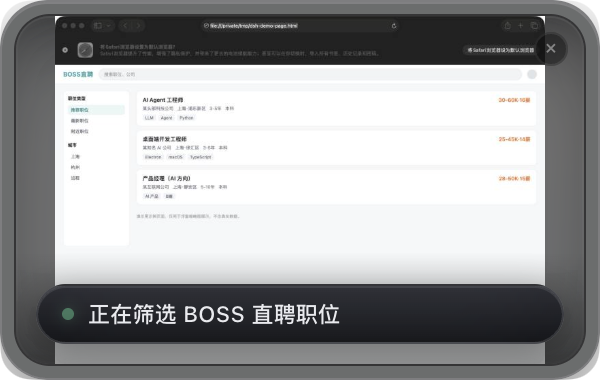

悬停胶囊展开动作日志（默认收起，最多保留 200 条）：

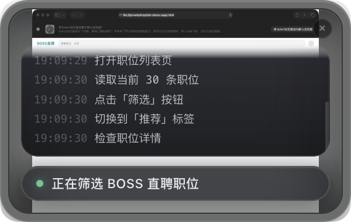

小窗固定在创建时所在的 Space：下面是同一屏幕区域在小窗所在 Space 与另一个 Space 的截图对比。

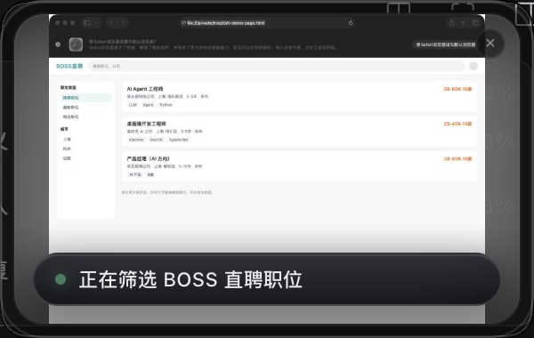

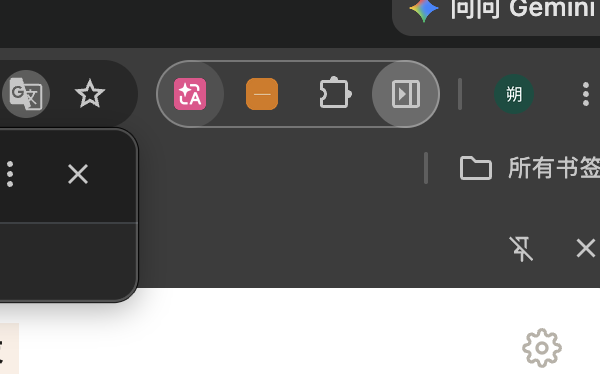

多会话：两个 sessionId 各一个小窗，画面、状态、日志互不影响：

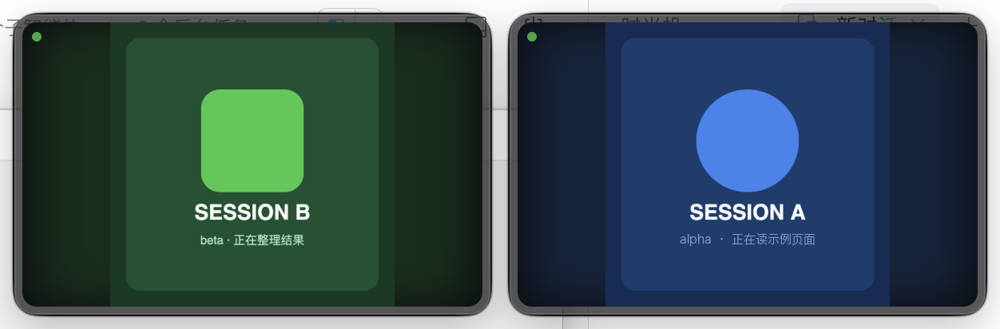

外观改版（同一内容、同一窗口尺寸，只改信息层级）：

改前（只有左上角状态点，悬停才有一行小字）：

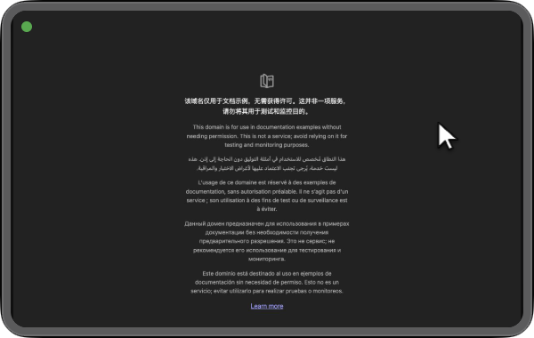

改后（底部一条克制的状态胶囊：状态点 + 正在做什么 + 已用时；画面仍是主体）：

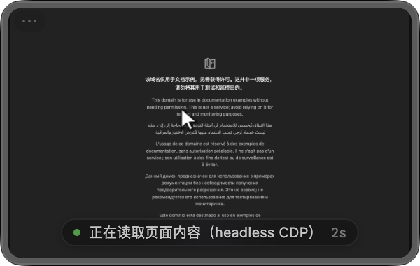

异常态（给一句人话原因 + 可操作按钮，点「重试」立刻重抓）：

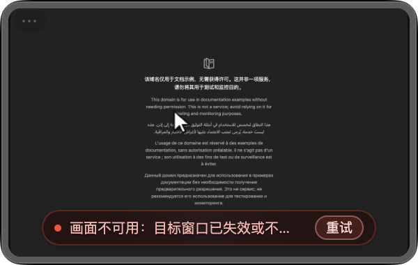

同一时刻只显示「当前 DSH 前台会话」的窗口——两个会话各推一次 status 后，切换会话时 only-current：

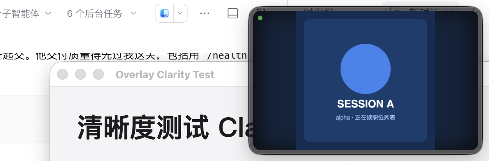

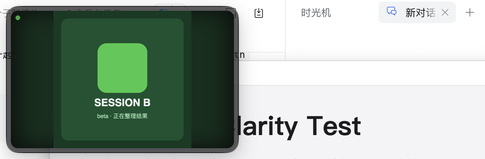

缩略图管线升级后的清晰度（小窗 300x190，截图按 Retina 2x 抓取，文字可读）：

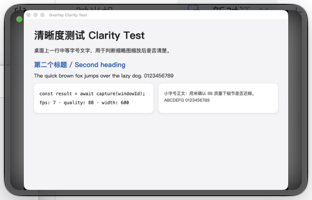

放大态：窗口比例按最近一帧画面自适应（无上下黑边），四周一圈 1px 细黑边：

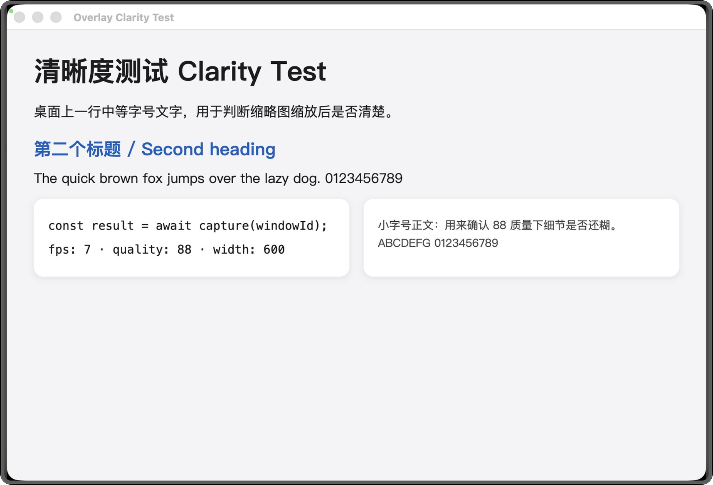

> 预览里的缩略图内容来自一个本地示例页面（demo，不含真实数据），不是 DeepSeek Harness 自己的窗口。

## 交互

- 出现/消失：收到 POST /log、POST /status、POST /window 时淡入显示；最后一次活动后 5 秒（OVERLAY_IDLE_HIDE_MS 可调，0 关闭）自动隐藏，进程不退出；再次有活动自动出现。
- 悬停暂停：鼠标停在某个小窗上时暂停自动隐藏；但为了防「悬停标记卡住」，超过 max(15 秒, idleHideMs×3) 完全没有活动仍会强制隐藏。
- 标题门控：带 titleHint 的会话只在 DSH 当前前台会话标题命中时显示；没有 titleHint 的会话保持旧行为（只要 DSH 在前台就可显示）。
- 手动开关：POST /visible {"visible":true} 固定显示（暂停自动隐藏），{"visible":false} 立即淡出隐藏。
- 悬停/点击底部胶囊：日志抽屉滑出（悬停临时展开，点击可固定，鼠标移出窗口自动收起；胶囊和面板之间留了缓冲，不会瞬间收起）。
- 点击穿透：默认整窗对鼠标穿透，点击落到下面的 DSH 页面；只有**中央 ⤢**、右上角 ✕、左上角状态胶囊、四周 8px 拖拽条会临时接管鼠标（/health 的 clickThrough 可查当前是否穿透）。
- 拖动：只能从四周/顶部 8px 的拖拽条拖（不再整窗可拖）；拖动后该窗口位置固定，空闲仍会隐藏。
- 缩放：拖窗口边缘（最小 250 x 160）。
- 关闭：点右上角 ×，或先点一下浮窗再按 Esc。
- 状态色：灰点待命、绿点运行中（轻微呼吸）、红点出错；状态文字一行，超长省略。

## 不跟随 Space

窗口只在创建时所在的 Space 显示，切换桌面不会跟过去：

- 实现：窗口保持默认的「只在一个 Space」行为（配合 alwaysOnTop 'screen-saver'）。
  注意不要在新窗口 show 之前调 win.setVisibleOnAllWorkspaces(false)：实测会让后创建的窗口挂到一个不存在的 Space，Electron 里 isVisible()=true，但 CGWindowList 里 onscreen=0，屏幕上根本看不到。
- 实测：窗口创建于 Space 1781；切到 Space 1 后，窗口仍记录在 Space 1781（CGWindowList / CGSCopySpacesForWindows），当前 Space 上不可见；切回来重新出现。
- 副作用（有意为之）：如果用户切到别的 Space，此时 agent 仍在活动，小窗会在它自己的 Space 淡入，而不是跟到用户眼前；切回原 Space 才能看到。

## 自身窗口保护

小窗永远不会把 DeepSeek Harness 自己的窗口（以及 overlay 自己的窗口）当作被控目标：

- 启动时和每次 GET /windows 都会扫描一遍窗口，标题命中 DeepSeek Harness / dsh / Desktop Agent 的记录进 selfWindowIds。
- GET /windows 返回的每一项带 self 字段，方便调用方过滤。
- POST /window 绑定自身窗口时返回 HTTP 403 和明确错误，目标窗口保持不变；overlay 日志里也会记一条系统提示。

## 多会话（multi-session）

每个 sessionId 一个独立 BrowserWindow：位置、显隐、缩略图、日志、状态、空闲计时全部隔离。
写入权限由接口的 session 字段决定，缺省 `default`，所以旧客户端（不带 session）行为不变。

- 创建：第一次收到某个 session 的 /status、/log、/window、/visible、/frame、/expand 请求时按需建窗；默认会话在启动时创建。
- 平铺：同一个 DSH 窗口内按格子排布（右上角起、水平排满换行），互不重叠；用户拖动后该窗口位置固定。
- 关闭：`POST /close {"session":"alpha"}` 只销毁该会话窗口，其它会话不受影响；全部关掉后进程与 HTTP 服务仍在，下一条 session 请求会重新召唤窗口。
- 上限：默认最多 12 个会话（OVERLAY_MAX_SESSIONS 可调），超出返回 409。
- 标题门控（会话隔离）：overlay 每秒读一次 DSH 主窗口标题（如「规划布局探讨 — DeepSeek Harness」），匹配前先去掉「— DeepSeek Harness」后缀。
  - 某会话第一次推 /status 或 /log 时，如果没有显式传 titleHint，会自动把「当时的 DSH 标题」记成该会话的 titleHint。
  - 之后每次轮询：当前 DSH 标题包含该 hint → 允许显示；不包含 → 自动隐藏（放大态也隐藏）。只看得见当前前台会话自己的小窗。
  - `POST /status`/`POST /log` 也可以显式传 `"titleHint":"规划布局探讨"` 覆盖自动绑定；传空字符串等于清掉。
  - DSH 标题读不到（osascript 失败）时保持旧行为，不会把所有窗口误藏。
  - 命中状态见 /health 的 matched / titleHint / dshTitle；/sessions 里也能看到每个会话的 matched。

- 层级：窗口用 floating 层级（不用 screen-saver 全局置顶），配合「DSH 不是前台就 hide」，只浮在 DSH 上面，不会盖住其它 App。
- 会话标识允许 1–64 位字母/数字/点/下划线/连字符，其余返回 400。

agent 侧（core/agentd.mjs）读取环境变量 AGENT_SESSION（缺省 default），overlay 客户端所有请求自动带上 session。

## 文件

- main.js         主进程：窗口、HTTP 服务、screencapture 抓帧、HUD 显隐与状态机
- server.js       零依赖本地 HTTP 接口（node:http），可单独 require 做测试
- window-id.js    windowID 解析（环境变量 / 命令行 / desktopCapturer 的 source id 写法）
- preload.js      contextBridge 暴露给渲染进程的最小 API
- renderer.js     渲染进程：状态胶囊、日志抽屉、缩略图交叉淡入
- index.html      手机浮窗样式 UI（内联样式，CSP 白名单）
- smoke-http.js   不需要 Electron 的接口层自检
- package.json    依赖与脚本（electron 只声明，不随仓库提交）
- .gitignore      忽略 npm install 产生的 node_modules/
- docs/           界面截图（默认态、日志展开态、Space 对比）
- README.md       本文件

## 安装与启动

Electron 二进制不随仓库提交，首次需要安装（约 100–200 MB，会联网下载）：

    cd desktop-agent/overlay
    npm install

启动（本机环境里有 ELECTRON_RUN_AS_NODE=1，必须显式去掉，否则 Electron 会以 Node 模式运行、起不来窗口）：

    env -u ELECTRON_RUN_AS_NODE ./node_modules/.bin/electron .

npm start 也可以，但如果因为 ELECTRON_RUN_AS_NODE 起不来，就用上面这行 env -u 的命令。

### 屏幕录制权限

缩略图靠系统 screencapture 抓取其他应用的窗口，必须有「屏幕录制」权限。首次抓图时 macOS 会弹权限提示，或手动到：

    系统设置 → 隐私与安全性 → 屏幕录制

勾选启动浮窗的终端（Terminal / iTerm）或 Electron，然后重启浮窗。没有权限时缩略图显示「画面暂时不可用」，状态胶囊和日志仍正常。

## 指定被控窗口

三种方式任选其一：

1) 环境变量

    OVERLAY_WINDOW_ID=68544 env -u ELECTRON_RUN_AS_NODE ./node_modules/.bin/electron .

2) 命令行参数

    env -u ELECTRON_RUN_AS_NODE ./node_modules/.bin/electron . --window-id=68544

3) 运行中通过 HTTP 切换（不用重启）

    curl -s -X POST http://127.0.0.1:7788/window \
      -H 'Content-Type: application/json' \
      -d '{"windowId":68544}'

不指定窗口 ID 时缩略图位置显示「等待目标窗口」占位。

### 怎么拿到 windowID

最省事的方式：浮窗跑起来后直接读窗口列表（主进程用 Electron desktopCapturer 枚举，自身窗口会带 self:true）：

    curl -s http://127.0.0.1:7788/windows

如果浮窗还没跑起来，可用下面这段已在本机验证过的小工具（需要 clang，Command Line Tools 自带）：

    cat > /tmp/window-id.m <<'EOF'
    #import <Foundation/Foundation.h>
    #import <CoreGraphics/CoreGraphics.h>

    int main(void) {
      @autoreleasepool {
        CFArrayRef list = CGWindowListCopyWindowInfo(
            kCGWindowListOptionOnScreenOnly | kCGWindowListExcludeDesktopElements,
            kCGNullWindowID);
        for (NSDictionary *w in CFBridgingRelease(list)) {
          if ([w[(id)kCGWindowLayer] integerValue] != 0) continue;
          NSDictionary *b = w[(id)kCGWindowBounds];
          if ([b[@"Width"] doubleValue] < 200 || [b[@"Height"] doubleValue] < 150) continue;
          NSString *name = w[(id)kCGWindowName] ?: @"";
          printf("%ld\t%s\t%s\n",
                 (long)[w[(id)kCGWindowNumber] longValue],
                 [w[(id)kCGWindowOwnerName] UTF8String],
                 [name UTF8String]);
        }
      }
      return 0;
    }
    EOF
    clang -framework Foundation -framework CoreGraphics -o /tmp/window-id /tmp/window-id.m
    /tmp/window-id

输出三列：windowID、应用名、窗口标题。

## HTTP 接口

默认监听 127.0.0.1:7788，只收 JSON 请求体。所有接口都支持 session：POST 用请求体里的 `session` 字段，GET 用 `?session=`；缺省 `default`。

    方法  路径                请求体                                         说明
    GET   /health?session=x   -                                              某个会话的状态快照（不存在返回 exists:false，不建窗）
    GET   /sessions           -                                              当前所有会话摘要
    GET   /windows            -                                              可截图窗口列表（self 标记自身窗口，全局共用）
    POST  /log                {"session","text","titleHint"}                 追加动作日志（最长 1000 字）
    POST  /status             {"session","text","state","titleHint"}        更新状态胶囊；state 可选 idle/running/error
    POST  /window             {"session","windowId"}                        切换该会话的缩略图目标；绑定自身窗口返回 403
    POST  /visible            {"session","visible":true|false}              手动显示/隐藏该会话；true 时固定显示
    POST  /expand             {"session"}                                   该会话切换放大（比例按最近一帧画面自适应）
    POST  /frame              {"session","dataUrl","note","cursor","width","height"}  外部推帧（含虚拟光标），接管该会话缩略图
    POST  /close              {"session"}                                   关掉该会话窗口（其它会话不受影响）

GET /health 关键字段：

    ok           是否正常
    session      会话 id
    exists       该会话窗口是否存在
    status       状态胶囊文字
    activity     idle / running / error（状态点颜色）
    visible      当前是否显示（自动隐藏/标题门控后为 false）
    idleMs       空闲隐藏时长（默认 5000，0 表示关闭自动隐藏）
    hardHideMs   强制隐藏兜底时长：max(15000, idleMs*3)，悬停标记卡住也会到点隐藏
    hovering     主进程轮询到的鼠标是否停在该窗口上（悬停暂停自动隐藏）
    clickThrough 当前是否处于鼠标穿透模式（true=点击落到下面的 DSH）
    pinned       是否被 POST /visible true 固定显示
    windowId     当前绑定的被控窗口
    titleHint    该会话的标题提示（没有则 null）
    matched      当前 DSH 前台会话标题是否命中 titleHint（没有 titleHint 恒为 true）
    dshTitle     当前读到的 DSH 主窗口标题
    hostVisible     宿主窗口当前是否真实可见（CGWindowList OnScreenOnly）
    hostBoundsStale 宿主窗口 bounds 是否来自缓存/读取失败（true 时不要相信 bounds）
    logs         当前保留的日志条数（上限 200）
    fps          最近 5 帧的平均帧率（本地抓帧和外部推帧都计入）
    frameBytes   最近一帧的真实图片字节数（不是 base64 长度）
    frames       该会话累计收到的帧数（本地抓帧 + 外部推帧）
    captureMs    最近一帧「抓图 + 缩放 + 编码」耗时
    frameWidth   最近一帧像素宽（放大时按它算宽高比）
    frameHeight  最近一帧像素高
    bounds       窗口屏幕坐标 {x,y,width,height}
    thumbnail    缩略图状态（state / updatedAt / error）

返回统一 JSON：成功 {"ok":true,...}，失败 {"ok":false,"error":"..."}；参数错误 400、绑定自身窗口 403、关闭不存在的会话 404、会话数超限 409、方法不对 405、未知路径 404。
/status 不传 state 时按文本推断（默认「待命」为空闲，其余为运行中）；传非法 state 会被忽略并回退推断。
只发 /log、从不发 /status 的 agent，也会在第一条日志到达时自动切成绿点运行中；显式 error 不会被日志覆盖。
连续的缩略图抓帧不计为活动，否则窗口永远不会自动隐藏；只有 agent 的 log/status/window/frame 事件会重置空闲计时。

### curl 示例

    # 旧客户端（不带 session，等同 default）
    curl -s http://127.0.0.1:7788/health

    curl -s -X POST http://127.0.0.1:7788/status \
      -H 'Content-Type: application/json' \
      -d '{"text":"正在后台操作应用","state":"running"}'

    # 多会话：alpha、beta 各自一个窗口
    curl -s -X POST http://127.0.0.1:7788/status \
      -H 'Content-Type: application/json' \
      -d '{"session":"alpha","text":"会话 A 正在读列表","titleHint":"规划布局探讨"}'

    curl -s -X POST http://127.0.0.1:7788/log \
      -H 'Content-Type: application/json' \
      -d '{"session":"beta","text":"beta 点击了筛选"}'

    curl -s http://127.0.0.1:7788/sessions
    curl -s 'http://127.0.0.1:7788/health?session=alpha'
    curl -s -X POST http://127.0.0.1:7788/close \
      -H 'Content-Type: application/json' \
      -d '{"session":"alpha"}'

    curl -s -X POST http://127.0.0.1:7788/visible \
      -H 'Content-Type: application/json' \
      -d '{"session":"alpha","visible":true}'

    curl -s -X POST http://127.0.0.1:7788/expand \
      -H 'Content-Type: application/json' \
      -d '{"session":"alpha"}'

    curl -s http://127.0.0.1:7788/windows

    curl -s -X POST http://127.0.0.1:7788/window \
      -H 'Content-Type: application/json' \
      -d '{"session":"alpha","windowId":68544}'

## 环境变量

    变量                  默认值           说明
    OVERLAY_WINDOW_ID     -                被控窗口 CGWindowID（兼容 WINDOW_ID）
    OVERLAY_PORT          7788             本地 HTTP 端口
    OVERLAY_HOST          127.0.0.1        监听地址；改成 0.0.0.0 会暴露到局域网，不建议
    OVERLAY_FPS           7                缩略图帧率，限制在 1–12（默认约 143ms 一帧）
    OVERLAY_WIDTH         300              窗口宽
    OVERLAY_HEIGHT        190              窗口高
    OVERLAY_MARGIN        16               距屏幕右上角的边距
    OVERLAY_IDLE_HIDE_MS  5000             空闲多久自动隐藏；0 关闭自动隐藏（强制兜底 = max(15s, 3×该值)）
    OVERLAY_MAX_SESSIONS  12               最多同时存在多少个会话窗口
    OVERLAY_SHOW_DOCK     0                设为 1 保留 Dock 图标（默认隐藏，accessory 模式）

## 状态表达与异常提示（设计规则）

- 状态点 + 一句话放到底部胶囊：只在 running / error / 画面不可用时出现，idle 时整条隐藏，避免文字压过画面；胶囊半透明毛玻璃、10px 小字、行高 1.2，深色下不刺眼。
- 正在做什么：直接显示 agent 推送的 status 文案（超长省略，title 里保留全文）；running 时右侧显示已用时（1s 粒度，只在运行中走）。
- 出错要能救：抓帧失败时显示「画面不可用：<人话原因>」+ 一个按钮。原因匹配权限/授权/屏幕录制 → 按钮「打开设置」（打开系统屏幕录制设置）；窗口失效/不可见 → 按钮「重试」（主进程清掉外部帧接管并立即重抓）。错误态不显示运行计时，红点 + 淡红胶囊但不刺眼。
- 点击穿透不变：状态胶囊本身 pointer-events:none，只有错误操作按钮（以及原有 ⤢/✕、左上日志入口、8px 拖拽条）会接管鼠标；主进程只在错误按钮可见时才把底部区域算作热区。
- 左上角保留极小的「⋯」日志入口（悬停显示会话名、点击固定日志面板），日志抽屉底边抬高到状态胶囊上方。
- 放大态（按画面比例）与普通态用同一套字号/间距/胶囊样式，不会只在小时好看。
- 不改变窗口尺寸（仍 300×190，可缩放/可放大），不改空闲 5 秒自动隐藏，不改不抢焦点。

## 宿主可见性（小窗不会“悬浮在壁纸上”）

- 旧实现把 System Events 读到的宿主 bounds 缓存住；当 DSH 被最小化/隐藏、或 System Events/AX 通道失效时，小窗会按旧坐标继续显示，屏幕上看起来像“贴在壁纸上”。
- 现在每次轮询都用 CGWindowList（Quartz，OnScreenOnly）直接查「屏幕上真实存在的宿主窗口」：读得到才更新标题/位置；读不到（最小化/隐藏/别的 Space/窗口不存在）→ hostVisible=false，立刻把该宿主下的小窗全部收起。
- 如果 CGWindowList 通道本身失败（osascript 出错），不会据此断言宿主不可见：只标记 hostBoundsStale=true，并退回 System Events 兜底；连续失败时保留缓存但不把“读不到”当成“没窗口”。
- /health 增加 `hostVisible`、`hostBoundsStale` 两个可区分字段；`bounds` 即使来自缓存也不会再被当成“宿主可见”的依据。

## 视觉与动画

- 整窗：14px 圆角、**最外层 1px 细黑边**（border，不遮画面；实测四边均为约 1 个逻辑像素的黑线），内侧一层 1px 半透明白色高光（inset shadow），深色半透明底 + 柔和外阴影。
- 卡片：缩略图 contain 显示完整窗口，同一帧再铺一张模糊放大的背景图做氛围。
- 胶囊：左侧 6px 状态点，悬停时才显示状态文字；非 default 会话在悬停时额外显示一小段会话名。
- 日志抽屉：圆角毛玻璃面板，从胶囊方向滑出，150ms 过渡；内容超出时顶部渐隐，不出现被裁掉的半行；滚动条极细。
- 动画克制：窗口整体 180ms 透明度淡入淡出（main 进程 setOpacity 过渡，不是瞬间 show/hide）；缩略图先在内存解码再替换，不会闪白；空闲隐藏是立即 hide（不淡出），保证「没操作就一定消失」。
- 放大态：窗口尺寸按最近一帧画面的宽高比计算（目标宽 = 可用宽 ×0.72，高 = 宽 × frameH/frameW；没有画面时回退 4:3），不会出现上下/左右黑边；用户手动缩放后不会被自动改回去。

## 不抢焦点的实现

- BrowserWindow 以 show:false 创建，ready-to-show 后用 showInactive() 显示；隐藏用 win.hide()；全程不调用 app.focus() / win.focus() / win.show()。
- 层级用 setAlwaysOnTop(true, 'floating')（不是 screen-saver 全局置顶），并且 DSH 不在前台就 hide，所以不会盖住别的 App。
- 默认 setIgnoreMouseEvents(true, { forward: true }) 整窗点击穿透；只有按钮/状态胶囊/8px 拖拽条热区临时切回可交互。
- app.setActivationPolicy('accessory') + app.dock.hide()：不出现 Dock 图标，也不参与 Cmd+Tab。
- 实测：POST /log 触发显示前后，lsappinfo front 的前台应用保持不变。
- 只有用户主动点击浮窗时它才会拿到键盘焦点（系统行为）。
- 关闭即退出进程，退出前清理截图临时目录和定时器。

## 缩略图实现

- 分辨率：按「小窗宽度 × 2（Retina）」出图，上限 1600 像素；放大到 4:3 大窗时窗口变宽，目标分辨率自动跟着变大（实测量到 frameWidth=1600）。
- 质量：最终 JPEG 质量 88（原 72）。
- 静止降频：连续多帧内容完全一样时抓帧周期按 2 倍退避（下限 2fps），画面一有变化立刻回满帧率。
  实测静止窗口 6 秒内抓帧 36 次 → 12 次，省 CPU/电，但变化最多半秒就能看到。
- 帧率：默认 15fps 上限（OVERLAY_FPS 可调 1–30）。真实窗口抓图约 6fps（screencapture 单帧约 150ms），离屏推帧约 13fps；/health 的 fps 是最近 5 帧的平均值，窗口隐藏时暂停抓帧。
- 抓图：`screencapture -x -o -l <windowID> -t png <临时文件>`（PNG 无损中间格式，避免 JPEG 二次编码），然后用 nativeImage 解码、只 resize 一次、再编码一次 JPEG。
- 调度：自调度而不是固定 setInterval——上一帧结束再按「目标周期 - 本帧耗时」安排下一帧，避免抓帧超过周期时被跳过一轮导致实际帧率只有一半。同一时刻只允许一帧在抓（per-session 锁）。
- 外部推帧（/frame）：见下一节「外部帧 / headless 画面」。
- 窗口隐藏时暂停抓帧，显示时立刻补一帧；临时目录 mkdtemp，每帧用完即删，退出整目录删除。
- 失败（窗口关闭 / ID 失效 / 无屏幕录制权限 / 超时）保留最后一帧；同一错误只记一条日志，避免刷屏。
- /health 暴露 fps、frameBytes、frames、captureMs、frameWidth、frameHeight 便于验收。

## 外部帧 / headless 画面（CDP 截图）

headless 浏览器在用户屏幕上没有窗口，画面只能靠 CDP 截图推给 /frame。约定：

    POST /frame
    {
      "session": "headless",
      "dataUrl": "data:image/jpeg;base64,...",
      "note": "headless CDP 截图",
      "width": 1280, "height": 800,
      "cursor": { "x": 640, "y": 400, "click": false }
    }

- dataUrl 支持 JPEG/PNG；width/height 可选（画面像素尺寸）。不传时按「上一帧尺寸 → 图片头解析 → 未知」处理；JPEG 读 SOF、PNG 读 IHDR，不整图解码；传了尺寸就完全跳过解析，连续推流时主进程开销最低。
- cursor 是画面像素坐标（与截图同尺寸），渲染进程映射到 object-fit: contain 后的位置画白色虚拟光标；click:true 触发一次扩散波纹。传 cursor:null 或不传会隐藏光标；本地抓帧不带 cursor 字段，保持光标不动。
- 连续推帧：每帧都会刷新 externalFrameAt/缩略图/活动时间，窗口持续显示，fps 按最近 5 帧计算；只有最后一次外部帧 3 秒后本地 screencapture 才恢复，期间不会抢画面。
- body 上限 8MB（大 PNG 也能推）；图片质量由推流方决定（建议 JPEG quality 80 左右，1280 宽约 60KB/帧）。
- 不重编码外部帧：原图直出给渲染进程（CSS 缩放显示），避免二次编码糊化。
- 实测：headless Chrome + example.com 连续推 20 帧（1280×800 JPEG q80，含移动光标和第 10 帧点击），约 2.2 秒推完，/health：fps≈11.9、frameBytes=59031、frames=25、frameWidth=1280、frameHeight=800、clickThrough=true，窗口全程可见且未抢焦点；截图 docs/headless-cdp-frame.png、docs/headless-cdp-click.png。

## 验收记录（macOS 26.5.1 + Electron 41.7.1）

启动命令（launchd 也要带 env -u ELECTRON_RUN_AS_NODE）：

    env -u ELECTRON_RUN_AS_NODE ./node_modules/.bin/electron .

多会话（本次改造实测）：

- 旧客户端兼容：GET /health（不带 session）→ session=default、exists=true；POST /status、/log（不带 session）→ session=default。
- 两个会话隔离：alpha、beta 各推 status/log，/sessions 返回 3 个窗口（含 default），两个窗口各自出现、bounds 不同（平铺在 DSH 内）、互不影响。
- 关一个不影响另一个：POST /close alpha → 200，/sessions 里 alpha 消失，beta 仍 visible=true/pinned=true，窗口 CGWindowList 仍 onscreen=1。
- 标题门控（硬验收）：alpha/auto1 绑定当前 DSH 标题（规划布局探讨）→ matched=true、可见；beta/auto2 绑定「另一个会话」→ matched=false、窗口隐藏（onscreen=0）。切换绑定后只看到另一个窗口。截图 docs/title-gate-a.png / title-gate-b.png。
- 自动绑定：某会话第一次推 status 且没带 titleHint → /health.titleHint 自动变成「规划布局探讨」（去掉「— DeepSeek Harness」后缀），matched=true。
- 关掉所有会话窗口后进程和 HTTP 服务仍在，下一条 session 请求会重新建窗。

缩略图管线（实测）：

- 小窗 300x190：fps=6.9~7.1，frameBytes≈27KB，captureMs≈83ms，frameWidth=600、frameHeight=409（300×2）。
- 放大态 960x654（按 600x409 的画面比例算）：frameWidth=1600、frameHeight=1091，fps=6.9，captureMs≈84ms，frameBytes≈100KB；截图四周无黑边，文字清晰（docs/clarity-expanded.png）。
- 放大比例核对：bounds 宽高比 1.4679 vs 帧宽高比 1.4670，误差 <0.001。
- 用户手动缩放后窗口尺寸保持（不会被自动改回）。

显隐与交互（实测）：

- 推一次 /status：0.8s 内 visible=true；不再操作 5 秒后 visible=false。
- 悬停暂停：真实鼠标停在窗上，8 秒仍 visible=true；继续停到 20 秒，兜底强制 visible=false（hardHideMs=15000）。
- 拖拽条：鼠标在顶部 8px 条内 clickThrough=false；从上边条拖 80px，窗口 y 坐标 49→129；之后空闲仍隐藏，位置保持。
- 点击穿透：clickThrough=true 时点击小窗中心（1346,200），点击落到下面的测试窗口（日志记录 CLICK 714,48 H1），小窗自身无反应；把鼠标移到**中央 ⤢** 上 clickThrough 变 false，点击可触发放大（expanded=true）。
- UI 变更说明（2026-11-08）：已删掉红色「■ 停止任务」按钮；放大 ⤢ 从右上角移到**窗口中央**（浏览器全屏按钮样式，hover 才出现）。下面这些截图大多摄于旧版 UI（右上角 ⤢、含红色停止钮），以实际界面为准；待重拍清单见 `overlay/docs/` 与验收任务。
- 放大截图：docs/clarity-expanded.png；小窗清晰度截图：docs/clarity-small.png；多会话截图：docs/multi-session.png。
- 外观改版数据（外部帧 example.com 1280×800，窗口仍 300×190）：改前 fps=10、frameBytes=59031、clickThrough=true；改后 fps=9.2、frameBytes=59031、clickThrough=true；运行中状态胶囊显示「正在读取页面内容（headless CDP） 2s」，悬停/日志交互不变；空闲 7 秒后 visible=false（未 pinned），pinned 时按规则保持；放大态 960×600 截图状态胶囊位置/字号一致（docs/ui-after.png、docs/ui-after-error.png、docs/ui-before.png）。
- 宿主可见性：把宿主进程名临时改成不存在的应用后重启，/health hostVisible=false、hostBoundsStale=true、visible=false，CGWindowList 里没有任何 Desktop Agent 窗口；恢复后 hostVisible=true、hostBoundsStale=false、小窗重新出现。DSH 真身隐藏（System Events set visible=false）在锁屏状态下 CGWindowList 仍会列出窗口，属于系统锁屏行为，解锁后按 OnScreenOnly 判定。
- 外部帧 / headless：连续推 20 帧 example.com（1280×800 JPEG），20/20 返回 200，耗时约 2.2 秒；/health fps=11.9、frameBytes=59031（真实字节）、frames=25、frameWidth=1280、frameHeight=800、clickThrough=true、thumbnail.state=live；第一帧就带 cursor 时立即出现光标；无 width/height 的 3024×1964 PNG 也能从 IHDR 自动认出尺寸；非法 width 返回 400。截图 docs/headless-cdp-frame.png、docs/headless-cdp-click.png。

## 自检

不需要 Electron 也能验证接口层与参数解析：

    cd desktop-agent/overlay
    npm run check     # 全部 JS 语法检查
    npm run smoke     # 起临时端口 HTTP 服务并断言各接口与错误分支

预期输出：

    PASS window-id helpers
    PASS http server
    ALL PASS

## 已知限制

- 桌面背景模糊依赖 CSS backdrop-filter：胶囊和日志抽屉会模糊其后的缩略图，效果贴近 iOS 浮窗。
- 透明窗口在系统开启「降低透明度」时观感会更实。
- 缩略图只抓「绑定的那个窗口」；窗口 ID 变化需重新 POST /window。
- 真实窗口刚绑定时可能连续几次抓不到图（系统要补画被遮挡窗口，报 `could not create image from window`）：
  现在连续失败 4 次才报错，中间用 120ms 快速重试，实测 1–3 秒内出第一帧且不会飘红。
- 抓帧耗时受系统负载影响：重负载时 screencapture 可能升到 200ms+，fps 会暂时掉到 4~5；空闲后恢复到 8–13fps（实测 12.7fps / 49ms 一帧）。
- GET /windows 依赖 desktopCapturer 和屏幕录制权限，权限缺失时返回 500；本机部分窗口（非当前 Space / 被遮挡）可能不在列表里，可直接用 CGWindowID 绑。
- 默认贴主屏右上角，不跟随显示器变化；小窗只在自身 Space 显示。
- 连续的缩略图抓帧不计入活动，因此有画面时也会按空闲规则隐藏（刻意设计）。
- 标题门控依赖 osascript 读 System Events 窗口标题；读不到标题时保持旧行为（全部可显示），避免误藏。
- 不同会话的窗口在同一个 DSH 窗口内平铺；会话很多时（>4）会换行、更多时会互相压住。
- HTTP 接口无鉴权，默认只监听回环地址。